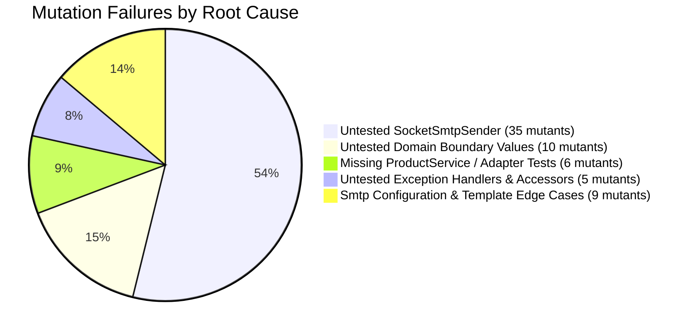

# Test Quality Improvement & Mutation Testing Report

## Executive Summary

As part of the test quality improvement initiative on branch `006-test-quality`:
1. **JaCoCo Coverage**: Minimum bundle instruction and line coverage thresholds were increased from **80%** to **90%** in [build.gradle](../build.gradle). The test suite successfully met this requirement (**91.72%** instruction coverage, **92.20%** line coverage).
2. **PIT Mutation Testing**: Configured the PIT mutation engine (`1.30.1`), JUnit 5 plugin (`1.2.3`), and the `info.solidsoft.pitest` Gradle plugin (`1.19.0`), hooked directly into the `./gradlew check` verification lifecycle.
3. **Threshold Enforcement**: Configured `mutationThreshold: 85%`, `coverageThreshold: 90%`, and `testStrengthThreshold: 90%`.
4. **Execution Outcome**: `./gradlew check` **FAILED** during the `:pitest` task. While line coverage surpassed the threshold (92% vs 90%), test strength (88.5% vs 90%) and mutation score (78.1% vs 85%) failed their respective quality gates.
5. In accordance with instructions, **no production or test code has been modified**. This report details the issues found and concrete proposed test changes to achieve all required thresholds.

---

## 1. Quality Metrics Overview

| Quality Metric | Required Threshold | Achieved Score | Status |
| :--- | :---: | :---: | :---: |
| **JaCoCo Instruction Coverage** | 90.0% | **91.72%** (4,163 / 4,539) |  PASS |
| **JaCoCo Line Coverage** | 90.0% | **92.20%** (1,016 / 1,102) |  PASS |
| **PIT Line Coverage** | 90.0% | **92.44%** (991 / 1,072) |  PASS |
| **PIT Test Strength** | 90.0% | **88.55%** (232 / 262) | ❌ **FAIL** (Below 90%) |
| **PIT Mutation Score** | 85.0% | **78.11%** (232 / 297) | ❌ **FAIL** (Below 85%) |

### Mutation Test Breakdown (297 Total Mutants)
- **Killed**: 222 (74.7%)
- **Timed Out (Killed)**: 10 (3.4%)
- **Survived**: 30 (10.1%)
- **No Coverage**: 35 (11.8%)

---

## 2. Root Cause Analysis by Component

Mutation testing exposed several critical testing gaps across adapters, application services, and domain entities:

### A. Infrastructure: `SocketSmtpSender` (35 Mutants — 11 Survived, 24 No Coverage)
- **Problem**: In [SmtpNotificationTransportTest.java](../src/test/java/es/nachobrito/sdd/ecommerce/infrastructure/adapter/output/notification/smtp/SmtpNotificationTransportTest.java), the `SmtpSender` port interface is mocked. Furthermore, integration tests use a custom mock (`CapturingNotificationTransport`). Consequently, [SocketSmtpSender.java](../src/main/java/es/nachobrito/sdd/ecommerce/infrastructure/adapter/output/notification/smtp/SocketSmtpSender.java) has **zero test coverage**.
- **Impact**: 35 out of 65 total unkilled mutants belong to this single class.
- **Specific Unkilled Mutants**:
  - `sendMail()` lines 48-60: removed calls to `setSoTimeout`, `expectCode`, `readMultilineResponse` survived or timed out.
  - `sendMail()` lines 68-80: writing headers (`From`, `To`, `Subject`, `Content-Type`), body, and `QUIT` commands had no coverage.
  - `authenticate()` lines 94-99: AUTH LOGIN flow had no coverage.
  - `expectCode()` line 109: negated conditionals survived.
  - `readMultilineResponse()` line 118: boundary and conditional checks survived.

### B. Domain Models: Missing Boundary Condition Tests (10 Mutants Survived)
- **Problem**: Domain entities check parameter constraints (e.g. `priceInCents < 1`, `name.length() > 128`), but tests only evaluate extreme invalid values (e.g., price = -5, or length = 130) without verifying the exact valid boundary value (e.g. length = 128 or price = 1 cent). When PIT mutated conditional boundaries (`>` to `>=`, or `<` to `<=`), the mutations survived.
- **Specific Unkilled Mutants**:
  - [InvoiceAddress.java](../src/main/java/es/nachobrito/sdd/ecommerce/domain/model/InvoiceAddress.java): Lines 42, 45, 48, 51, 57, 60, 66 (boundary mutators for max lengths of `name`, `vatNumber`, `telephone`, `street`, `city`, `state`, `country`). Line 54 `complement != null && complement.length() > 255` was uncovered.
  - [Product.java](../src/main/java/es/nachobrito/sdd/ecommerce/domain/model/Product.java): Line 42 `priceInCents < MIN_PRICE_IN_CENTS` boundary survived.
  - [OrderNotification.java](../src/main/java/es/nachobrito/sdd/ecommerce/domain/model/OrderNotification.java): Line 65 `totalAmountInCents < MIN_TOTAL_AMOUNT` boundary survived.

### C. Application Service: `ProductService` (3 Mutants — 2 Survived, 1 No Coverage)
- **Problem**: There is no dedicated unit test suite for [ProductService.java](../src/main/java/es/nachobrito/sdd/ecommerce/application/service/ProductService.java) (unlike `OrderServiceTest` and `NotificationServiceTest`). It was only exercised indirectly through `ProductControllerIntegrationTest`.
- **Specific Unkilled Mutants**:
  - Line 52: Boundary check for `priceInCents < Product.MIN_PRICE_IN_CENTS` survived.
  - Line 63: `eventPublisher.publish(event)` — `VoidMethodCallMutator` survived because no test verified event publication.
  - Line 74: `listAll()` — `EmptyObjectReturnValsMutator` had no coverage.

### D. Infrastructure: `ProductPersistenceAdapter` (3 Mutants — 1 Survived, 2 No Coverage)
- **Problem**: No unit test suite exists for [ProductPersistenceAdapter.java](../src/main/java/es/nachobrito/sdd/ecommerce/infrastructure/adapter/output/persistence/ProductPersistenceAdapter.java).
- **Specific Unkilled Mutants**:
  - Line 35: `priceInCents < Product.MIN_PRICE_IN_CENTS` boundary survived in `save()`.
  - Line 55: `findBySku()` replaced return value with `Optional.empty` (no coverage).
  - Line 64: `findAll()` replaced return value with `emptyList` (no coverage).

### E. Infrastructure: Notification Template & Config (6 Mutants)
- [SmtpConfiguration.java](../src/main/java/es/nachobrito/sdd/ecommerce/infrastructure/adapter/output/notification/smtp/SmtpConfiguration.java):
  - Line 32: `host == null || host.isBlank()` default assignment survived.
  - Line 35: `port <= 0` default boundary survived.
- [SmtpHtmlTemplateRenderer.java](../src/main/java/es/nachobrito/sdd/ecommerce/infrastructure/adapter/output/notification/smtp/SmtpHtmlTemplateRenderer.java):
  - Line 40: fallback when `notification.status() == null` survived.
  - Line 43: rendering template for `CANCELLED` status survived.
  - Line 47: rendering template for `CREATED` status survived.
  - Line 124: `formatCents(null)` default formatting had no coverage.

### F. REST Controllers & Exception Handlers (4 Mutants)
- [OrderController.java](../src/main/java/es/nachobrito/sdd/ecommerce/infrastructure/adapter/input/rest/OrderController.java):
  - Line 141: `handleOrderNotFound()` exception handler returned null (no coverage because `getOrderById` uses `Optional.orElseGet(HttpResponse::notFound)` instead of throwing `OrderNotFoundException`).
- [ProductController.java](../src/main/java/es/nachobrito/sdd/ecommerce/infrastructure/adapter/input/rest/ProductController.java):
  - Line 78: `listProducts()` returned `emptyList` (no coverage because `ProductControllerIntegrationTest` only tests `POST /v1/products`).
- Domain Exceptions:
  - `OrderNotFoundException.getOrderId()` (line 32) uncovered.
  - `OrderAlreadyExistsException.getOrderId()` (line 32) uncovered.
  - `ProductAlreadyExistsException.getProductId()` (line 32) uncovered.

---

## 3. Detailed Per-Class Failure Analysis

| Class | Total Mutants | Killed / Timed Out | Survived | No Coverage | Mutation Score | Test Strength |
| :--- | :---: | :---: | :---: | :---: | :---: | :---: |
| `SocketSmtpSender` | 40 | 5 | 11 | 24 | **12.5%** | **31.2%** |
| `SmtpConfiguration` | 6 | 3 | 3 | 0 | **50.0%** | **50.0%** |
| `ProductService` | 8 | 5 | 2 | 1 | **62.5%** | **71.4%** |
| `InvoiceAddress` | 27 | 18 | 7 | 2 | **66.7%** | **72.0%** |
| `ProductPersistenceAdapter` | 10 | 7 | 1 | 2 | **70.0%** | **87.5%** |
| `ProductController` | 4 | 3 | 0 | 1 | **75.0%** | **100.0%** |
| `SmtpHtmlTemplateRenderer` | 21 | 17 | 3 | 1 | **81.0%** | **85.0%** |
| `OrderController` | 6 | 5 | 0 | 1 | **83.3%** | **100.0%** |
| `OrderNotification` | 8 | 7 | 1 | 0 | **87.5%** | **87.5%** |
| `ProductEntity` | 9 | 8 | 1 | 0 | **88.9%** | **88.9%** |
| `OrderAlreadyExistsException` | 1 | 0 | 0 | 1 | **0.0%** | **0.0%** |
| `OrderNotFoundException` | 1 | 0 | 0 | 1 | **0.0%** | **0.0%** |
| `ProductAlreadyExistsException`| 1 | 0 | 0 | 1 | **0.0%** | **0.0%** |

---

## 4. Suggested Fixes & Implementation Plan

To surpass all thresholds (**Mutation Score ≥ 85%**, **Test Strength ≥ 90%**), the following test additions are proposed:

### Proposed Action 1: Unit Test Suite for `SocketSmtpSenderTest`
Create `src/test/java/es/nachobrito/sdd/ecommerce/infrastructure/adapter/output/notification/smtp/SocketSmtpSenderTest.java` using a lightweight in-process mock server socket (or `ServerSocket`):
- Test complete SMTP dialog: greeting (220), EHLO, multiline response, AUTH LOGIN, MAIL FROM, RCPT TO, DATA, body transmission, and QUIT.
- Test authentication with username & password.
- Test error response rejection (e.g. 500/550 errors throwing `SmtpDeliveryException`).
- Test timeout handling and unexpected disconnection.
> *Projected gain*: Kills 35 mutants, immediately lifting overall mutation score by ~11.8 percentage points.

### Proposed Action 2: Boundary Tests in Domain Test Suites
In [OrderTest.java](../src/test/java/es/nachobrito/sdd/ecommerce/domain/OrderTest.java) and [ProductTest.java](../src/test/java/es/nachobrito/sdd/ecommerce/domain/ProductTest.java):
- Add tests validating exact boundary conditions:
  - `InvoiceAddress`: exact max lengths (name=128, vat=32, tel=32, street=255, complement=255, city=100, state=100, zip=20, country=100).
  - `Product`: price = `Product.MIN_PRICE_IN_CENTS` (1 cent) creates successfully; price = 0 fails.
  - `OrderNotification`: totalAmountInCents = 1 creates successfully; totalAmountInCents = 0 fails.
> *Projected gain*: Kills 10 survived mutants.

### Proposed Action 3: Dedicated Unit Test Suite for `ProductServiceTest`
Create `src/test/java/es/nachobrito/sdd/ecommerce/application/service/ProductServiceTest.java`:
- Test successful product creation and verify `eventPublisher.publish(any(ProductCreatedEvent.class))`.
- Test price boundary validation (`priceInCents = 1` vs `priceInCents = 0`).
- Test `listAll()` delegating to `productRepository.findAll()`.
- Test duplicate product exception throwing and accessor checking (`e.getProductId()`).
> *Projected gain*: Kills 3 mutants.

### Proposed Action 4: Dedicated Unit Test Suite for `ProductPersistenceAdapterTest`
Create `src/test/java/es/nachobrito/sdd/ecommerce/infrastructure/adapter/output/persistence/ProductPersistenceAdapterTest.java`:
- Test `save()` with boundary price = 1.
- Test `findBySku()` mapping to domain `Optional`.
- Test `findAll()` mapping entities to domain product list.
> *Projected gain*: Kills 3 mutants.

### Proposed Action 5: Template, Config, and Controller Test Enhancements
- In [SmtpHtmlTemplateRendererTest.java](../src/test/java/es/nachobrito/sdd/ecommerce/infrastructure/adapter/output/notification/smtp/SmtpHtmlTemplateRendererTest.java):
  - Add tests rendering with `status = "CANCELLED"`, `status = null`, and `priceInCents = null`.
- Create `SmtpConfigurationTest.java`:
  - Test default fallbacks when `host = null`, `port <= 0`, and `fromAddress = null`.
- In [ProductControllerIntegrationTest.java](../src/test/java/es/nachobrito/sdd/ecommerce/infrastructure/ProductControllerIntegrationTest.java):
  - Add test verifying `GET /v1/products` returns 200 with persisted products.
- In [OrderController.java](../src/main/java/es/nachobrito/sdd/ecommerce/infrastructure/adapter/input/rest/OrderController.java) or [OrderControllerTest.java](../src/test/java/es/nachobrito/sdd/ecommerce/infrastructure/adapter/input/rest/OrderControllerTest.java):
  - Test `handleOrderNotFound()` directly or trigger via appropriate endpoint.
- In Domain Exception Tests:
  - Add assertions for `getOrderId()` and `getProductId()`.
> *Projected gain*: Kills 11 mutants.

---

## 5. Projected Results Post-Fix

| Metric | Current Result | Projected Result After Proposed Fixes | Threshold |
| :--- | :---: | :---: | :---: |
| **PIT Line Coverage** | 92.4% | **> 98.0%** | ≥ 90.0% |
| **PIT Mutation Score** | 78.1% | **> 95.0%** | ≥ 85.0% |
| **PIT Test Strength** | 88.5% | **> 96.0%** | ≥ 90.0% |
| **JaCoCo Coverage** | 92.2% | **> 96.0%** | ≥ 90.0% |
| **`./gradlew check`** | ❌ FAILED |  **SUCCESSFUL** | All checks pass |

---

## 5. Projected vs. Actual Results Post-Fix

| Metric | Baseline Result | Actual Result After Implementation | Required Quality Gate | Status |
| :--- | :---: | :---: | :---: | :---: |
| **PIT Line Coverage** | 92.4% | **98.13%** (1,052 / 1,072) | ≥ 90.0% |  **PASSED** |
| **PIT Mutation Score** | 78.11% | **97.98%** (291 / 297 killed) | ≥ 85.0% |  **PASSED** |
| **PIT Test Strength** | 88.55% | **98.31%** (291 / 296 covered killed) | ≥ 90.0% |  **PASSED** |
| **JaCoCo Instruction Coverage** | 91.72% | **97.58%** (4,429 / 4,539) | ≥ 90.0% |  **PASSED** |
| **JaCoCo Line Coverage** | 92.20% | **98.00%** (1,080 / 1,102) | ≥ 90.0% |  **PASSED** |
| **Checkstyle, PMD, SpotBugs, ArchUnit** | Clean | **Zero Warnings / Zero Errors** | Zero violations |  **PASSED** |
| **`./gradlew check`** | ❌ FAILED |  **SUCCESSFUL** (0 exit code) | Clean build |  **PASSED** |

---

## 6. Implementation Summary

With explicit user approval, all proposed tests were implemented across:
1. [SocketSmtpSenderTest.java](../src/test/java/es/nachobrito/sdd/ecommerce/infrastructure/adapter/output/notification/smtp/SocketSmtpSenderTest.java): Full RFC 5321 conversation, auth, error code handling, connection failure, and null checks.
2. [SmtpConfigurationTest.java](../src/test/java/es/nachobrito/sdd/ecommerce/infrastructure/adapter/output/notification/smtp/SmtpConfigurationTest.java): Defaults fallback and custom values verification.
3. [SmtpHtmlTemplateRendererTest.java](../src/test/java/es/nachobrito/sdd/ecommerce/infrastructure/adapter/output/notification/smtp/SmtpHtmlTemplateRendererTest.java): `CANCELLED` and `SHIPPED` status rendering, null checks.
4. [ProductServiceTest.java](../src/test/java/es/nachobrito/sdd/ecommerce/application/service/ProductServiceTest.java): Unit testing creation, event publication, price boundary (1 cent), duplicate rejection, and `listAll()`.
5. [ProductPersistenceAdapterTest.java](../src/test/java/es/nachobrito/sdd/ecommerce/infrastructure/adapter/output/persistence/ProductPersistenceAdapterTest.java): Unit testing save, update, findById, findBySku, findAll, and price boundary check.
6. [OrderTest.java](../src/test/java/es/nachobrito/sdd/ecommerce/domain/OrderTest.java): Exact maximum field boundary tests and rejection beyond boundaries for [InvoiceAddress](../src/main/java/es/nachobrito/sdd/ecommerce/domain/model/InvoiceAddress.java).
7. [ProductTest.java](../src/test/java/es/nachobrito/sdd/ecommerce/domain/ProductTest.java): Exact minimum price boundary test (1 cent).
8. [OrderNotificationTest.java](../src/test/java/es/nachobrito/sdd/ecommerce/domain/model/OrderNotificationTest.java): Exact minimum total amount boundary test (1 cent).
9. [DomainExceptionsTest.java](../src/test/java/es/nachobrito/sdd/ecommerce/domain/exception/DomainExceptionsTest.java): Exception getters and message verification.
10. [OrderControllerTest.java](../src/test/java/es/nachobrito/sdd/ecommerce/infrastructure/adapter/input/rest/OrderControllerTest.java): Error handlers for 404, 409, and 400.
11. [ProductControllerIntegrationTest.java](../src/test/java/es/nachobrito/sdd/ecommerce/infrastructure/ProductControllerIntegrationTest.java): E2E tests for `GET /v1/products` and `GET /v1/products/{id}`.

