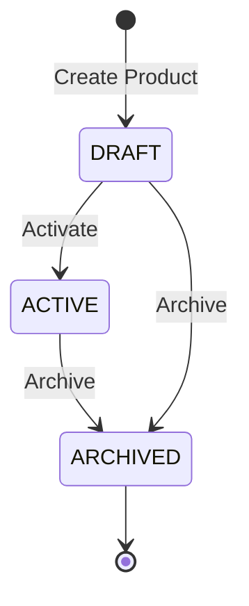

# Data Model: E-Commerce REST API Foundation

**Feature Branch**: `001-project-setup`  
**Date**: 2026-10-25  
**Spec**: [spec.md](./spec.md)  

## Foundational Domain Entities

### 1. Product (Catalog Aggregate Root)

Represents a core sellable product item within the e-commerce domain. Used as the reference entity to validate Hexagonal Architecture, Micronaut Data JDBC persistence, Liquibase migrations, and event bus publishing.

#### Attributes

| Field | Type | Constraints | Description |
|---|---|---|---|
| `id` | `UUID` | Primary Key, Non-null | Unique identifier for the product |
| `sku` | `String` | Non-null, Unique, Pattern `^[A-Z0-9-]{3,32}$` | Stock Keeping Unit |
| `name` | `String` | Non-null, Length 1-128 | Human-readable product name |
| `description` | `String` | Nullable, Max length 1024 | Detailed product description |
| `price` | `BigDecimal` | Non-null, Min 0.01 | Product selling price |
| `currency` | `String` | Non-null, Length 3, ISO-4217 | Currency code (e.g., USD, EUR) |
| `status` | `ProductStatus` | Non-null, Enum | Lifecycle status: `DRAFT`, `ACTIVE`, `ARCHIVED` |
| `createdAt` | `Instant` | Non-null, UTC | Timestamp when product was created |
| `updatedAt` | `Instant` | Non-null, UTC | Timestamp when product was last updated |

#### State Transitions



### 2. Domain Events

#### ProductCreatedEvent

Emitted asynchronously across the internal application event bus whenever a new product aggregate is created.

| Attribute | Type | Description |
|---|---|---|
| `eventId` | `UUID` | Unique event identifier |
| `eventType` | `String` | Constant `product.created.v1` |
| `productId` | `UUID` | Identifier of created product |
| `sku` | `String` | SKU of created product |
| `timestamp` | `Instant` | ISO-8601 UTC timestamp |
| `traceId` | `String` | Correlation trace ID from OpenTelemetry context |

---

## Database Schema (MariaDB / Liquibase)

### Table: `products`

```sql
CREATE TABLE products (
    id VARCHAR(36) NOT NULL PRIMARY KEY,
    sku VARCHAR(32) NOT NULL,
    name VARCHAR(128) NOT NULL,
    description VARCHAR(1024),
    price DECIMAL(10, 2) NOT NULL,
    currency VARCHAR(3) NOT NULL,
    status VARCHAR(20) NOT NULL,
    created_at TIMESTAMP NOT NULL DEFAULT CURRENT_TIMESTAMP,
    updated_at TIMESTAMP NOT NULL DEFAULT CURRENT_TIMESTAMP ON UPDATE CURRENT_TIMESTAMP,
    CONSTRAINT uk_products_sku UNIQUE (sku)
) ENGINE=InnoDB DEFAULT CHARSET=utf8mb4 COLLATE=utf8mb4_unicode_ci;
```
