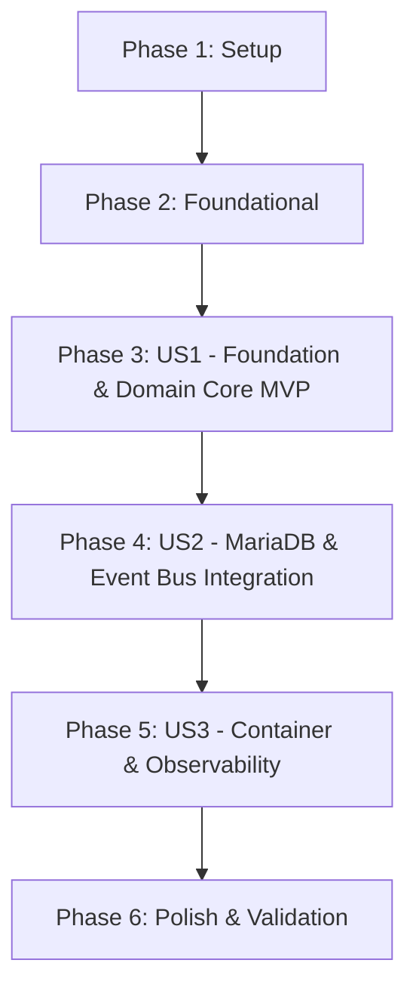

# Tasks: E-Commerce REST API Project Foundation

**Input**: Design documents from `/specs/001-project-setup/`
**Prerequisites**: plan.md (required), spec.md (required for user stories), research.md, data-model.md, contracts/

## Format: `[TaskID] [P?] [Story?] Description with file path`

- **[P]**: Can run in parallel (different files, no dependencies)
- **[Story]**: Which user story this task belongs to (e.g., US1, US2, US3)
- Explicit file paths included in all task descriptions

## Path Conventions

Single project repository layout:
- `src/main/java/es/nachobrito/sdd/ecommerce/...`
- `src/main/resources/...`
- `src/test/java/es/nachobrito/sdd/ecommerce/...`
- `src/test/resources/...`
- Root automation: `Makefile`, `build.gradle`, `settings.gradle`, `Dockerfile`, `AGENTS.md`

---

## Phase 1: Setup (Shared Infrastructure)

**Purpose**: Project initialization, build automation, and code quality tool configuration

- [X] T001 Initialize Gradle project build script with Java 25 toolchain, Micronaut 4.10 plugins, and dependency management in `build.gradle` and `settings.gradle`
- [X] T002 [P] Configure strict Checkstyle ruleset with zero warnings allowed in `config/checkstyle/checkstyle.xml` and integrate with check task in `build.gradle`
- [X] T003 [P] Configure strict PMD ruleset with zero warnings allowed in `config/pmd/pmd.xml` and integrate with check task in `build.gradle`
- [X] T004 [P] Configure SpotBugs static analysis plugin and filters with max effort and zero tolerance in `config/spotbugs/exclude.xml` and `build.gradle`
- [X] T005 Configure Conventional Commits git hook script and SemVer version management in `build.gradle` and `version.txt`

---

## Phase 2: Foundational (Blocking Prerequisites)

**Purpose**: Architectural layers, compliance test harness, and environment configuration

**⚠️ CRITICAL**: No user story work can begin until this phase is complete

- [X] T006 Create main application entry point and Hexagonal Architecture package boundaries in `src/main/java/es/nachobrito/sdd/ecommerce/Application.java`
- [X] T007 Configure ArchUnit compliance test enforcing strict Hexagonal Architecture boundaries in `src/test/java/es/nachobrito/sdd/ecommerce/architecture/HexagonalArchitectureTest.java`
- [X] T008 [P] Configure Micronaut base and environment application settings in `src/main/resources/application.yml` and `src/test/resources/application-test.yml`
- [X] T009 [P] Configure structured JSON logging with high-cardinality MDC fields (traceId, timestamp, eventType) in `src/main/resources/logback.xml`

**Checkpoint**: Foundation ready - architectural tests and quality gates enforce boundary constraints.

---

## Phase 3: User Story 1 - Developer Builds and Validates Project Foundation (Priority: P1) 🎯 MVP

**Goal**: Deliver a verifiable, compile-time-safe Hexagonal domain slice with strict quality gating where all checks pass on every build.

**Independent Test**: Execute `./gradlew check` to verify clean compilation under Java 25, zero Checkstyle/PMD/SpotBugs warnings, and 100% ArchUnit layer isolation.

### Tests for User Story 1

- [X] T010 [P] [US1] Create pure domain unit tests verifying Product state transitions and validation rules without mocks in `src/test/java/es/nachobrito/sdd/ecommerce/domain/ProductTest.java`

### Implementation for User Story 1

- [X] T011 [P] [US1] Implement Product aggregate root and ProductStatus enum in `src/main/java/es/nachobrito/sdd/ecommerce/domain/model/Product.java` and `src/main/java/es/nachobrito/sdd/ecommerce/domain/model/ProductStatus.java`
- [X] T012 [P] [US1] Define inbound use case ports CreateProductUseCase and GetProductUseCase in `src/main/java/es/nachobrito/sdd/ecommerce/domain/port/inbound/CreateProductUseCase.java` and `src/main/java/es/nachobrito/sdd/ecommerce/domain/port/inbound/GetProductUseCase.java`
- [X] T013 [P] [US1] Define outbound repository port ProductRepositoryPort in `src/main/java/es/nachobrito/sdd/ecommerce/domain/port/outbound/ProductRepositoryPort.java`
- [X] T014 [US1] Implement ProductService orchestrating domain operations with explicit constructor injection in `src/main/java/es/nachobrito/sdd/ecommerce/application/service/ProductService.java`
- [X] T015 [US1] Implement Micronaut AOP crosscutting structured logging annotation and interceptor in `src/main/java/es/nachobrito/sdd/ecommerce/application/aop/StructuredLog.java` and `src/main/java/es/nachobrito/sdd/ecommerce/application/aop/LoggingInterceptor.java`
- [X] T016 [US1] Execute `./gradlew check` to confirm Java 25 compilation, ArchUnit compliance, and static quality checks pass green

**Checkpoint**: User Story 1 complete and independently verifiable as an MVP.

---

## Phase 4: User Story 2 - Integration Testing with Ephemeral Backing Services (Priority: P2)

**Goal**: Seamlessly provision MariaDB and RabbitMQ via Micronaut TestResources, execute Liquibase migrations, and verify REST endpoints with REST Assured.

**Independent Test**: Run `./gradlew test` to execute end-to-end integration tests with automated container provisioning and REST Assured HTTP validations.

### Tests for User Story 2

- [X] T017 [P] [US2] Implement REST Assured integration test verifying HTTP endpoints against MariaDB TestResource in `src/test/java/es/nachobrito/sdd/ecommerce/infrastructure/ProductControllerIntegrationTest.java`
- [X] T018 [P] [US2] Implement event bus integration test verifying asynchronous domain event publishing in `src/test/java/es/nachobrito/sdd/ecommerce/infrastructure/EventBusIntegrationTest.java`

### Implementation for User Story 2

- [X] T019 [P] [US2] Configure Micronaut TestResources for MariaDB and RabbitMQ in `build.gradle` and `src/test/resources/application-test.yml`
- [X] T020 [P] [US2] Create Liquibase master changelog and initial products table schema migration in `src/main/resources/db/changelog/db.changelog-master.xml` and `src/main/resources/db/changelog/changes/001-create-products-table.xml`
- [X] T021 [US2] Implement Micronaut Data JDBC Entity and compile-time Repository in `src/main/java/es/nachobrito/sdd/ecommerce/infrastructure/adapter/output/persistence/ProductEntity.java` and `src/main/java/es/nachobrito/sdd/ecommerce/infrastructure/adapter/output/persistence/MicronautProductRepository.java`
- [X] T022 [US2] Implement ProductPersistenceAdapter implementing ProductRepositoryPort in `src/main/java/es/nachobrito/sdd/ecommerce/infrastructure/adapter/output/persistence/ProductPersistenceAdapter.java`
- [X] T023 [P] [US2] Define ProductCreatedEvent and outbound EventPublisherPort in `src/main/java/es/nachobrito/sdd/ecommerce/domain/event/ProductCreatedEvent.java` and `src/main/java/es/nachobrito/sdd/ecommerce/domain/port/outbound/EventPublisherPort.java`
- [X] T024 [US2] Implement event bus publisher adapter using Micronaut ApplicationEventPublisher and RabbitMQ in `src/main/java/es/nachobrito/sdd/ecommerce/infrastructure/adapter/output/messaging/EventBusAdapter.java`
- [X] T025 [US2] Implement REST controller and request/response DTOs per OpenAPI contract in `src/main/java/es/nachobrito/sdd/ecommerce/infrastructure/adapter/input/rest/ProductController.java` and `src/main/java/es/nachobrito/sdd/ecommerce/infrastructure/adapter/input/rest/dto/CreateProductRequest.java`

**Checkpoint**: User Story 2 complete with fully verified database migrations, persistence, and event integration.

---

## Phase 5: User Story 3 - Containerized Deployment and Observability (Priority: P3)

**Goal**: Package the application into a secure Docker container, expose OpenTelemetry metrics/tracing via Micrometer, and provide unified Makefile commands.

**Independent Test**: Build the Docker container, run health probes on `/health`, and verify telemetry metrics on `/prometheus`.

### Tests for User Story 3

- [X] T026 [P] [US3] Implement health check and metrics integration test in `src/test/java/es/nachobrito/sdd/ecommerce/infrastructure/HealthCheckIntegrationTest.java`

### Implementation for User Story 3

- [X] T027 [P] [US3] Configure Micrometer core, Prometheus registry, and OpenTelemetry HTTP tracing in `build.gradle` and `src/main/resources/application.yml`
- [X] T028 [P] [US3] Configure Micronaut Management endpoints for health and metrics in `src/main/resources/application.yml`
- [X] T029 [US3] Create multi-stage Dockerfile with non-root user and healthcheck probe in `Dockerfile`
- [X] T030 [US3] Create discoverable root Makefile providing single-command interface per Constitution Principle 10 in `Makefile`

**Checkpoint**: User Story 3 complete with containerization and observability validated.

---

## Phase 6: Polish & Cross-Cutting Concerns

**Purpose**: Repository hygiene, file ignore rules, and full build suite validation

- [X] T031 [P] Create `.gitignore` and `.dockerignore` for Java, Gradle, and container builds in `.gitignore` and `.dockerignore`
- [X] T032 Run full verification suite (`./gradlew check` and `make check`) to ensure 100% compliance across all checks and tests

---

## Dependencies & Execution Order

### Story Dependencies

- **US1 (Foundation & Domain Core)**: Depends only on Phase 1 & Phase 2. Delivers complete MVP.
- **US2 (Integration with MariaDB & Event Bus)**: Depends on US1 domain model and ports.
- **US3 (Containerization & Observability)**: Depends on US1/US2 deployable application.

### Parallel Execution Opportunities

- T002, T003, T004 (Checkstyle, PMD, SpotBugs configs) can run in parallel.
- T010, T011, T012, T013 (US1 Domain models, ports, and tests) can run in parallel.
- T017, T018 (US2 Integration tests) can be written in parallel before implementation.
- T027, T028 (US3 Observability and management configs) can run in parallel.
