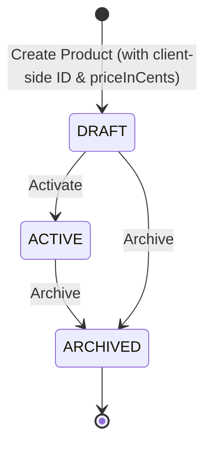

# Data Model: Product Aggregate Updates (Client-Side ID and Price in Cents)

**Feature Branch**: `002-update-product-aggregate`  
**Date**: 2026-10-25  
**Spec**: [spec.md](./spec.md)  

## Updated Domain Entities

### 1. Product (Catalog Aggregate Root)

Represents a core sellable product item within the e-commerce catalog, updated to support client-generated deterministic UUID identities and whole integer cent pricing.

#### Attributes

| Field | Type | Layer Validations | Description |
|---|---|---|---|
| `id` | `UUID` | **Controller**: `@NotNull`<br>**Service**: Uniqueness check via repository, non-null<br>**Domain**: `Objects.requireNonNull`<br>**Persistence**: Primary Key, `NOT NULL` | Client-generated unique identifier |
| `sku` | `String` | Non-null, Unique, Pattern `^[A-Z0-9-]{3,32}$` | Stock Keeping Unit |
| `name` | `String` | Non-null, Length 1-128 | Human-readable product name |
| `description` | `String` | Nullable, Max length 1024 | Detailed product description |
| `priceInCents` | `Integer` | **Controller**: `@NotNull`, `@Min(1)`<br>**Service**: `priceInCents != null && priceInCents >= 1`<br>**Domain**: `priceInCents >= 1`<br>**Persistence**: `INT NOT NULL CHECK (price_in_cents >= 1)` | Product selling price in whole integer cents (e.g., 1999 = $19.99) |
| `currency` | `String` | Non-null, Length 3, ISO-4217 | Currency code (e.g., USD, EUR) |
| `status` | `ProductStatus` | Non-null, Enum | Lifecycle status: `DRAFT`, `ACTIVE`, `ARCHIVED` |
| `createdAt` | `Instant` | Non-null, UTC | Timestamp when product was created |
| `updatedAt` | `Instant` | Non-null, UTC | Timestamp when product was last updated |

#### State Transitions



### 2. DTO Representations (REST Boundary)

#### `CreateProductRequest`

```java
@Serdeable
public record CreateProductRequest(
    @NotNull(message = "ID is required")
    UUID id,

    @NotBlank(message = "SKU is required")
    @Pattern(regexp = "^[A-Z0-9-]{3,32}$", message = "SKU must match pattern ^[A-Z0-9-]{3,32}$")
    String sku,

    @NotBlank(message = "Product name is required")
    @Size(min = 1, max = 128, message = "Product name must be between 1 and 128 characters")
    String name,

    @Nullable
    @Size(max = 1024, message = "Product description must not exceed 1024 characters")
    String description,

    @NotNull(message = "priceInCents is required")
    @Min(value = 1, message = "priceInCents must be at least 1 cent")
    Integer priceInCents,

    @NotBlank(message = "Currency is required")
    @Size(min = 3, max = 3, message = "Currency must be a 3-letter ISO code")
    String currency
) {}
```

#### `ProductResponse`

```java
@Serdeable
public record ProductResponse(
    UUID id,
    String sku,
    String name,
    @Nullable String description,
    Integer priceInCents,
    String currency,
    String status,
    Instant createdAt,
    Instant updatedAt
) {}
```

---

## Database Migration (MariaDB / Liquibase)

### Changeset: `002-add-price-in-cents.xml`

```xml
<?xml version="1.0" encoding="UTF-8"?>
<databaseChangeLog
  xmlns="http://www.liquibase.org/xml/ns/dbchangelog"
  xmlns:xsi="http://www.w3.org/2001/XMLSchema-instance"
  xsi:schemaLocation="http://www.liquibase.org/xml/ns/dbchangelog
         http://www.liquibase.org/xml/ns/dbchangelog/dbchangelog-latest.xsd">

  <changeSet id="002-add-price-in-cents" author="sdd-ecommerce">
    <!-- 1. Expand: Add new price_in_cents column -->
    <addColumn tableName="products">
      <column name="price_in_cents" type="INT">
        <constraints nullable="true"/>
      </column>
    </addColumn>

    <!-- 2. Backfill existing rows converting decimal price to integer cents -->
    <sql>
      UPDATE products 
      SET price_in_cents = CAST(ROUND(price * 100) AS INT) 
      WHERE price_in_cents IS NULL;
    </sql>

    <!-- 3. Make column NOT NULL once populated -->
    <addNotNullConstraint tableName="products" columnName="price_in_cents" columnDataType="INT"/>
  </changeSet>

</databaseChangeLog>
```
