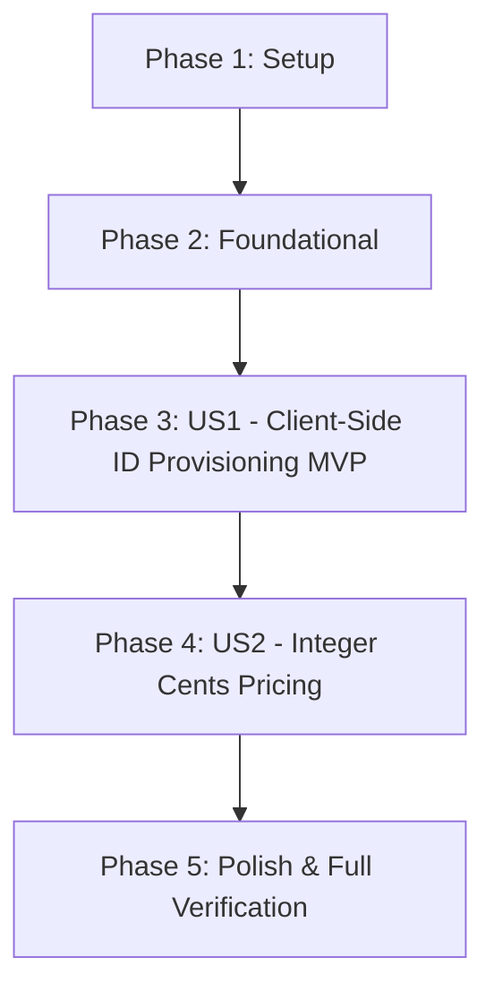

# Tasks: Product Aggregate Updates (Client-Side ID and Price in Cents)

**Input**: Design documents from `/specs/002-update-product-aggregate/`
**Prerequisites**: plan.md (required), spec.md (required for user stories), research.md, data-model.md, contracts/

## Format: `[TaskID] [P?] [Story?] Description with file path`

- **[P]**: Can run in parallel (different files, no dependencies)
- **[Story]**: Which user story this task belongs to (e.g., US1, US2)
- Explicit file paths included in all task descriptions

## Path Conventions

Single project repository layout:
- `src/main/java/es/nachobrito/sdd/ecommerce/...`
- `src/main/resources/...`
- `src/test/java/es/nachobrito/sdd/ecommerce/...`
- `src/test/resources/...`

---

## Phase 1: Setup (Shared Infrastructure)

**Purpose**: Database migration registration and contract synchronization

- [X] T001 Register new Liquibase changeset `002-add-price-in-cents.xml` in master changelog in `src/main/resources/db/changelog/db.changelog-master.xml`
- [X] T002 [P] Sync OpenAPI 3.1 specification contract with required client ID and integer price in cents in `specs/002-update-product-aggregate/contracts/openapi.yaml`

---

## Phase 2: Foundational (Blocking Prerequisites)

**Purpose**: Shared domain exceptions and database schema expansion

**⚠️ CRITICAL**: No user story work can begin until this phase is complete

- [X] T003 Create domain exception `ProductAlreadyExistsException` in `src/main/java/es/nachobrito/sdd/ecommerce/domain/exception/ProductAlreadyExistsException.java`
- [X] T004 Create Liquibase migration `002-add-price-in-cents.xml` adding column `price_in_cents INT` with data backfill in `src/main/resources/db/changelog/changes/002-add-price-in-cents.xml`

**Checkpoint**: Foundation ready - domain exception and DB migration structure available for story implementation.

---

## Phase 3: User Story 1 - Client-Side ID Provisioning for Product Creation (Priority: P1) 🎯 MVP

**Goal**: Deliver client-generated UUID support across all layers (Controller, Service, Domain, Repository) with strict validation and conflict handling.

**Independent Test**: Execute unit and integration tests verifying that POST `/v1/products` requires a client UUID, rejects missing/invalid IDs (HTTP 400), and rejects duplicate IDs (HTTP 409).

### Tests for User Story 1

- [X] T005 [P] [US1] Update unit tests to assert client-side ID validation, non-null requirements, and duplicate detection in `src/test/java/es/nachobrito/sdd/ecommerce/domain/ProductTest.java`

### Implementation for User Story 1

- [X] T006 [P] [US1] Update `Product` domain record constructor and factory method to require non-null client-provided UUID `id` in `src/main/java/es/nachobrito/sdd/ecommerce/domain/model/Product.java`
- [X] T007 [P] [US1] Update inbound use case port `CreateProductUseCase` to include `UUID id` parameter in `src/main/java/es/nachobrito/sdd/ecommerce/domain/port/inbound/CreateProductUseCase.java`
- [X] T008 [US1] Update `ProductService` to validate non-null `id`, check repository for existing ID, and throw `ProductAlreadyExistsException` upon duplicate in `src/main/java/es/nachobrito/sdd/ecommerce/application/service/ProductService.java`
- [X] T009 [P] [US1] Update `ProductPersistenceAdapter` to validate that `product.id()` is non-null before saving in `src/main/java/es/nachobrito/sdd/ecommerce/infrastructure/adapter/output/persistence/ProductPersistenceAdapter.java`
- [X] T010 [P] [US1] Update `CreateProductRequest` to require `@NotNull UUID id` with validation annotation in `src/main/java/es/nachobrito/sdd/ecommerce/infrastructure/adapter/input/rest/dto/CreateProductRequest.java`
- [X] T011 [US1] Update `ProductController` to pass `request.id()` to `createProductUseCase` and add `@Error` handler mapping `ProductAlreadyExistsException` to HTTP 409 Conflict in `src/main/java/es/nachobrito/sdd/ecommerce/infrastructure/adapter/input/rest/ProductController.java`
- [X] T012 [US1] Update REST Assured integration test asserting client ID generation, missing ID validation (400), and duplicate ID conflict (409) in `src/test/java/es/nachobrito/sdd/ecommerce/infrastructure/ProductControllerIntegrationTest.java`

**Checkpoint**: User Story 1 complete and independently verifiable as an MVP.

---

## Phase 4: User Story 2 - Product Pricing Expressed in Integer Cents (Priority: P2)

**Goal**: Express product prices strictly in integer cents (`priceInCents`) across all layers with multi-layer validation.

**Independent Test**: Execute unit and integration tests verifying that POST `/v1/products` requires integer `priceInCents >= 1`, returns `priceInCents` in responses, and rejects non-positive or missing prices.

### Tests for User Story 2

- [X] T013 [P] [US2] Update unit tests to verify `priceInCents` validation (min 1 cent, non-null) in `src/test/java/es/nachobrito/sdd/ecommerce/domain/ProductTest.java`

### Implementation for User Story 2

- [X] T014 [P] [US2] Update `Product` domain record to replace `BigDecimal price` with `Integer priceInCents` and validate `priceInCents >= 1` in `src/main/java/es/nachobrito/sdd/ecommerce/domain/model/Product.java`
- [X] T015 [P] [US2] Update `CreateProductUseCase` inbound port signature to accept `Integer priceInCents` in `src/main/java/es/nachobrito/sdd/ecommerce/domain/port/inbound/CreateProductUseCase.java`
- [X] T016 [US2] Update `ProductService` to validate `priceInCents` parameter and forward to domain factory in `src/main/java/es/nachobrito/sdd/ecommerce/application/service/ProductService.java`
- [X] T017 [P] [US2] Update `ProductEntity` to map `price_in_cents` property as `Integer priceInCents` in `src/main/java/es/nachobrito/sdd/ecommerce/infrastructure/adapter/output/persistence/ProductEntity.java`
- [X] T018 [US2] Update `ProductPersistenceAdapter` to map `priceInCents` between entity and domain with validation in `src/main/java/es/nachobrito/sdd/ecommerce/infrastructure/adapter/output/persistence/ProductPersistenceAdapter.java`
- [X] T019 [P] [US2] Update `CreateProductRequest` to replace `price` with `@NotNull @Min(1) Integer priceInCents` in `src/main/java/es/nachobrito/sdd/ecommerce/infrastructure/adapter/input/rest/dto/CreateProductRequest.java`
- [X] T020 [P] [US2] Update `ProductResponse` to return `Integer priceInCents` instead of `BigDecimal price` in `src/main/java/es/nachobrito/sdd/ecommerce/infrastructure/adapter/input/rest/dto/ProductResponse.java`
- [X] T021 [US2] Update `ProductController` to pass `request.priceInCents()` to use case in `src/main/java/es/nachobrito/sdd/ecommerce/infrastructure/adapter/input/rest/ProductController.java`
- [X] T022 [US2] Update REST Assured integration test to verify `priceInCents` validation (rejection of 0, negative values, and non-integer types) in `src/test/java/es/nachobrito/sdd/ecommerce/infrastructure/ProductControllerIntegrationTest.java`

**Checkpoint**: User Story 2 complete with fully verified integer cents pricing across all layers.

---

## Phase 5: Polish & Cross-Cutting Concerns

**Purpose**: Architecture verification, quality checks, and clean test execution

- [X] T023 [P] Verify ArchUnit package isolation rules remain clean in `src/test/java/es/nachobrito/sdd/ecommerce/architecture/HexagonalArchitectureTest.java`
- [X] T024 Run full verification suite (`./gradlew check` and `make check`) to ensure 100% compliance across all checks and tests

---

## Dependencies & Execution Order

### Story Dependencies

- **User Story 1 (P1)**: Depends on Phase 2 (Foundational). Can be delivered as an independent MVP.
- **User Story 2 (P2)**: Builds upon the aggregate structure established in US1; completes the aggregate transition.
- **Polish (Phase 5)**: Requires completion of US1 and US2.

### Parallel Opportunities

- Within Phase 1: T002 can run in parallel with T001.
- Within Phase 3 (US1): T005, T006, T007, T009, T010 can be developed in parallel as separate files.
- Within Phase 4 (US2): T013, T014, T015, T017, T019, T020 can be developed in parallel as separate files.

---

## Implementation Strategy

### MVP First (User Story 1 Only)

1. Complete Phase 1: Setup (changelog registration, OpenAPI contract).
2. Complete Phase 2: Foundational (`ProductAlreadyExistsException`, changelog).
3. Complete Phase 3: User Story 1 (Client-side ID generation & multi-layer validation).
4. **STOP and VALIDATE**: Run `./gradlew test` to verify User Story 1 independently.

### Incremental Delivery

1. Foundation ready.
2. Deliver US1 (Client-side ID) → verified.
3. Deliver US2 (Integer cents pricing) → verified.
4. Execute full `./gradlew check` gate.
