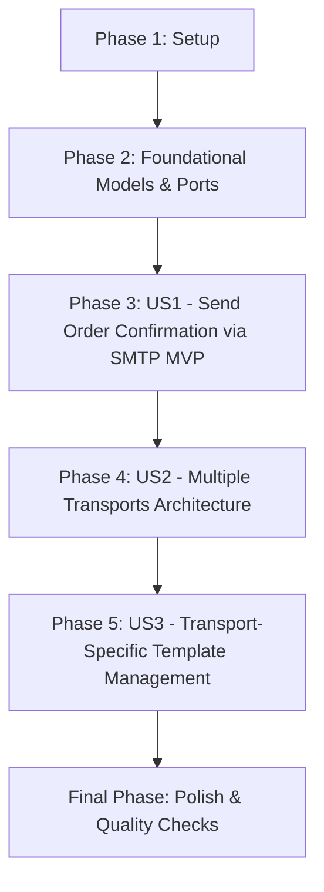

# Tasks: Order Notifications

**Input**: Design documents from `/specs/004-order-notifications/`  
**Prerequisites**: plan.md (required), spec.md (required for user stories), research.md, data-model.md, quickstart.md, contracts/

## Format: `[TaskID] [P?] [Story?] Description with file path`

- **[P]**: Can run in parallel (different files, no dependencies)
- **[Story]**: Which user story this task belongs to (e.g., [US1], [US2], [US3])
- Explicit file paths included in all task descriptions

## Path Conventions

Single project repository layout:
- `src/main/java/es/nachobrito/sdd/ecommerce/...`
- `src/main/resources/...`
- `src/test/java/es/nachobrito/sdd/ecommerce/...`
- `src/test/resources/...`

---

## Phase 1: Setup (Shared Infrastructure)

**Purpose**: Configuration setup and boundary contract alignment

- [X] T001 [P] Sync boundary domain event contract in `specs/004-order-notifications/contracts/order-created-event.json`
- [X] T002 Add SMTP configuration defaults to `src/main/resources/application.yml` and test overrides to `src/test/resources/application-test.yml`

---

## Phase 2: Foundational (Blocking Prerequisites)

**Purpose**: Core domain value objects, entities, and port interfaces

**⚠️ CRITICAL**: No user story work can begin until this phase is complete

- [X] T003 [P] Create value objects `NotificationAddress` and `NotificationLineItem` in `src/main/java/es/nachobrito/sdd/ecommerce/domain/model/NotificationAddress.java`
- [X] T004 [P] Create domain record `OrderNotification` with validation invariants in `src/main/java/es/nachobrito/sdd/ecommerce/domain/model/OrderNotification.java`
- [X] T005 [P] Create inbound driving port `SendOrderNotificationUseCase` in `src/main/java/es/nachobrito/sdd/ecommerce/domain/port/inbound/SendOrderNotificationUseCase.java`
- [X] T006 [P] Create outbound driven port `NotificationTransportPort` in `src/main/java/es/nachobrito/sdd/ecommerce/domain/port/outbound/NotificationTransportPort.java`
- [X] T007 [P] Create unit tests for `OrderNotification` invariant validation in `src/test/java/es/nachobrito/sdd/ecommerce/domain/model/OrderNotificationTest.java`

**Checkpoint**: Foundation ready - domain models, value objects, ports, and validations established.

---

## Phase 3: User Story 1 - Send Order Confirmation via SMTP HTML Email (Priority: P1) 🎯 MVP

**Goal**: Deliver end-to-end customer order notification via SMTP using an HTML email template upon receiving an `OrderCreatedEvent`.

**Independent Test**: Publish or trigger `OrderCreatedEvent`, verify that `NotificationService` retrieves the order and `SmtpNotificationTransport` compiles and sends the HTML email to the customer's address with complete order details.

### Tests for User Story 1

- [X] T008 [P] [US1] Create unit tests for `SmtpHtmlTemplateRenderer` verifying placeholder substitution and HTML escaping in `src/test/java/es/nachobrito/sdd/ecommerce/infrastructure/adapter/output/notification/smtp/SmtpHtmlTemplateRendererTest.java`
- [X] T009 [P] [US1] Create unit tests for `SmtpNotificationTransport` verifying email preparation and error isolation in `src/test/java/es/nachobrito/sdd/ecommerce/infrastructure/adapter/output/notification/smtp/SmtpNotificationTransportTest.java`
- [X] T010 [P] [US1] Create integration test for `OrderCreatedNotificationListener` and `NotificationService` in `src/test/java/es/nachobrito/sdd/ecommerce/infrastructure/adapter/input/messaging/OrderCreatedNotificationListenerTest.java`

### Implementation for User Story 1

- [X] T011 [P] [US1] Create HTML email template `order-confirmation.html` with responsive styles in `src/main/resources/templates/order-confirmation.html`
- [X] T012 [P] [US1] Create configuration record `SmtpConfiguration` with `@ConfigurationProperties("smtp")` in `src/main/java/es/nachobrito/sdd/ecommerce/infrastructure/adapter/output/notification/smtp/SmtpConfiguration.java`
- [X] T013 [P] [US1] Implement `SmtpHtmlTemplateRenderer` with classpath template loading and HTML-escaping in `src/main/java/es/nachobrito/sdd/ecommerce/infrastructure/adapter/output/notification/smtp/SmtpHtmlTemplateRenderer.java`
- [X] T014 [US1] Implement `SmtpNotificationTransport` implementing `NotificationTransportPort` with MIME message assembly in `src/main/java/es/nachobrito/sdd/ecommerce/infrastructure/adapter/output/notification/smtp/SmtpNotificationTransport.java`
- [X] T015 [US1] Implement `NotificationService` implementing `SendOrderNotificationUseCase`, querying `GetOrderUseCase` and dispatching to transports in `src/main/java/es/nachobrito/sdd/ecommerce/application/service/NotificationService.java`
- [X] T016 [US1] Implement `OrderCreatedNotificationListener` listening to `OrderCreatedEvent` and invoking `SendOrderNotificationUseCase` in `src/main/java/es/nachobrito/sdd/ecommerce/infrastructure/adapter/input/messaging/OrderCreatedNotificationListener.java`

**Checkpoint**: User Story 1 complete and independently verifiable as an MVP.

---

## Phase 4: User Story 2 - Multiple Transports Architecture (Priority: P2)

**Goal**: Support multiple active notification transports simultaneously, allowing additional delivery channels to be registered cleanly.

**Independent Test**: Register multiple mock `NotificationTransportPort` beans and verify that `NotificationService` dispatches notifications to all enabled transports and skips disabled transports.

### Tests for User Story 2

- [X] T017 [P] [US2] Create unit tests for `NotificationService` verifying multi-transport iteration, filtering, and empty transport handling in `src/test/java/es/nachobrito/sdd/ecommerce/application/service/NotificationServiceTest.java`

### Implementation for User Story 2

- [X] T018 [US2] Update `NotificationService` to inject `List<NotificationTransportPort>`, filter by `isEnabled()`, and dispatch to all active transports in `src/main/java/es/nachobrito/sdd/ecommerce/application/service/NotificationService.java`
- [X] T019 [US2] Add diagnostic warning logging when zero transports are enabled in `src/main/java/es/nachobrito/sdd/ecommerce/application/service/NotificationService.java`

**Checkpoint**: User Story 2 complete with multi-transport dispatching validated.

---

## Phase 5: User Story 3 - Transport-Specific Template Management (Priority: P3)

**Goal**: Ensure each transport manages its own medium-specific template independently without leaking transport details into core services.

**Independent Test**: Verify that the HTML template is completely encapsulated within the SMTP transport adapter and can be modified or rendered without affecting other transports or the domain model.

### Tests for User Story 3

- [X] T020 [P] [US3] Create tests verifying XSS injection mitigation in address/customer fields in `src/test/java/es/nachobrito/sdd/ecommerce/infrastructure/adapter/output/notification/smtp/SmtpHtmlTemplateRendererTest.java`
- [X] T021 [P] [US3] Create tests verifying null complement formatting in addresses in `src/test/java/es/nachobrito/sdd/ecommerce/infrastructure/adapter/output/notification/smtp/SmtpHtmlTemplateRendererTest.java`

### Implementation for User Story 3

- [X] T022 [US3] Enhance `SmtpHtmlTemplateRenderer` with robust HTML sanitization and null-safe address formatting in `src/main/java/es/nachobrito/sdd/ecommerce/infrastructure/adapter/output/notification/smtp/SmtpHtmlTemplateRenderer.java`
- [X] T023 [US3] Encapsulate template resolution logic within each transport adapter boundary in `src/main/java/es/nachobrito/sdd/ecommerce/infrastructure/adapter/output/notification/smtp/SmtpNotificationTransport.java`

**Checkpoint**: User Story 3 complete with independent template rendering verified.

---

## Final Phase: Polish & Cross-Cutting Concerns

**Purpose**: Static analysis, architectural validation, and documentation verification

- [X] T024 [P] Verify ArchUnit hexagonal architecture compliance for notification ports, adapters, and models in `src/test/java/es/nachobrito/sdd/ecommerce/architecture/HexagonalArchitectureTest.java`
- [X] T025 Execute `./gradlew check` to ensure Checkstyle, PMD, SpotBugs, ArchUnit, and all test suites pass with zero warnings
- [X] T026 Update user documentation and quickstart instructions in `specs/004-order-notifications/quickstart.md`

---

## Dependencies & Execution Order

### Story Dependencies
- **Foundational (Phase 2)**: Prerequisite for all user stories.
- **US1 (MVP)**: Can be implemented and tested immediately after Foundational.
- **US2**: Enhances `NotificationService` multi-transport dispatching built in US1.
- **US3**: Refines template encapsulation and security hardening established in US1.

### Parallel Opportunities [P]
- T001 and T002 in Setup can execute in parallel.
- T003, T004, T005, T006, and T007 in Foundational can execute in parallel.
- T008, T009, T010 in US1 testing can execute in parallel before implementation.
- T011, T012, T013 in US1 implementation can execute in parallel.
- T020 and T021 in US3 testing can execute in parallel.
